# bevy_niagara

A Niagara-style GPU particle system for [Bevy](https://bevyengine.org), with an importer for Unreal Niagara `.uasset` files.

- **fx_core**: the effect format (`.fx.ron`): systems, emitters, Niagara modules, the `fxc` checker and cooker
- **fx_gpu** / **fx_render**: GPU simulation, sorting and batched rendering (sprites, ribbons, meshes, lights, decals, volumes, heat-haze distortion)
- **fx_solari**: the Solari ray-traced path
- **fx_import**: reads Niagara `.uasset` packages (UE 4.27 and 5.x) and converts them to `.fx.ron`, with materials, textures and meshes (`fximport`)
- **fx_preview**: headless renders and videos (`fxpreview`) and GPU benchmarks (`fxbench`)
- **fx_viewer**, **fx_mcp**, **fx_bench**: live viewer, MCP server for authoring effects, benchmark suite

Effects live in [`effects/`](effects/README.md); benchmarks in [`bench/`](bench/README.md).

## Play: Wizard TD

**[Play Wizard TD in the browser](https://nub.github.io/bevy_niagara/wizard_td/)** (WebGPU: Safari 26+ on iPad and Mac, Chrome/Edge 113+).

A first-person wizard defends a tower against waves of foxes ([`examples/wizard_td`](examples/wizard_td/src/main.rs)). Every spell is a particle effect spawned through the game API: fireballs with ribbon trails and pooled explosions, chain lightning, frost novas, turrets that cast on their own, and debris whose collisions spawn dust through particle events. Desktop: WASD, mouse look, click to cast, 1–4 to pick a spell. iPad: the left thumb moves, dragging on the right looks, and the spell buttons cast at the crosshair. Quality drops automatically to hold 60 fps.

```sh
cargo run --release -p wizard_td                                   # desktop window
cargo run --release -p wizard_td -- --scripted --out DIR           # headless: a bot plays a minute, DIR/wizard_td.mp4
sh examples/wizard_td/web/build.sh && sh examples/wizard_td/web/serve.sh   # browser build on localhost:8080
sh examples/wizard_td/web/deploy.sh                                # publish to gh-pages/wizard_td/
```

## Gallery

All media is rendered headlessly with `fxpreview` (see `crates/fx_preview`).

### Imported from Niagara

Unreal Niagara systems converted by `fximport` and rendered with an Unreal-like look (`--look ue`). Perfect Fire VFX and Free Arrow Trail are third-party Fab packs; only these renders are included here, not the source files.

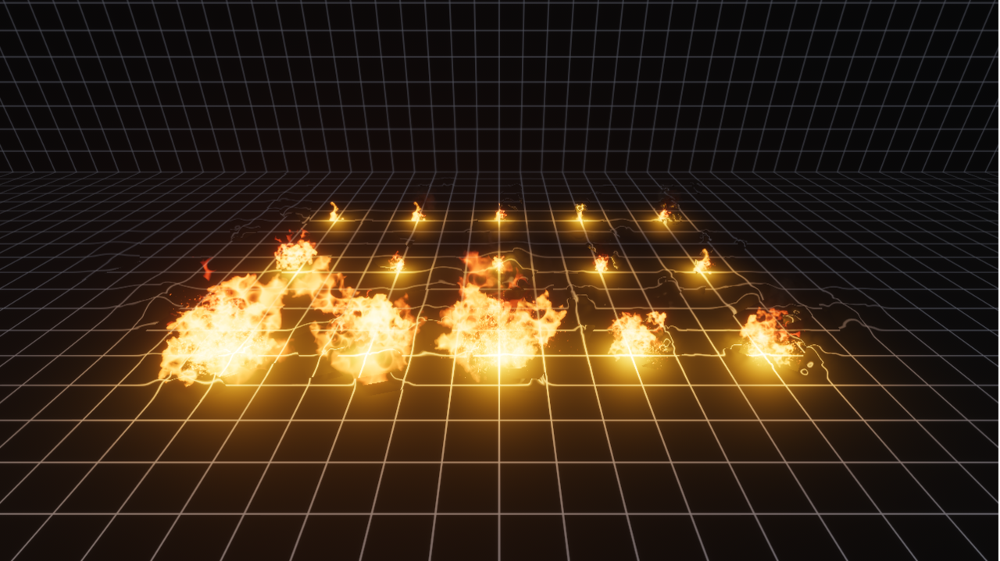

|   |   |   |
|:--:|:--:|:--:|
| 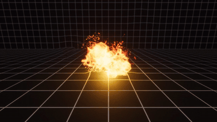<br>NS_Fire_Big | 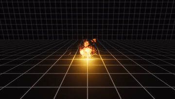<br>NS_Fire_Medium | 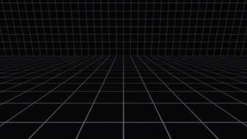<br>NS_Fire_Floor_01 |
| 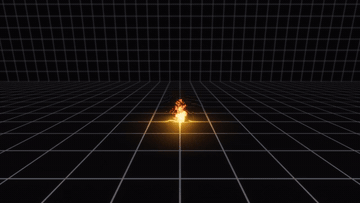<br>NS_Fire_Small_Smoke |  |  |

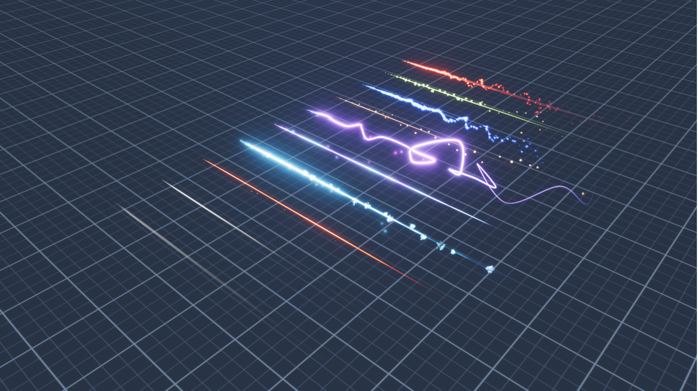

|   |   |   |
|:--:|:--:|:--:|
| 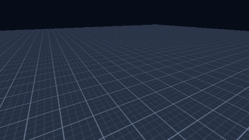<br>NS_ArrowTrail_Fire | 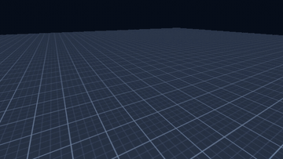<br>NS_ArrowTrail_Ice | 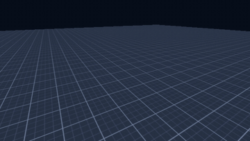<br>NS_ArrowTrail_Magic |
| 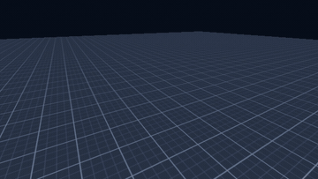<br>NS_ArrowTrail_Holy |  |  |

### Built-in effects

Authored in [`effects/library`](effects/library/README.md).

|   |   |   |
|:--:|:--:|:--:|
| 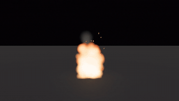<br>campfire | 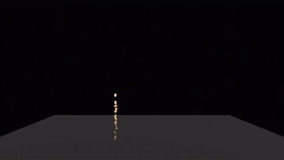<br>fireworks_show | 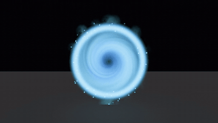<br>portal_vortex |
| <br>lightning_strike | 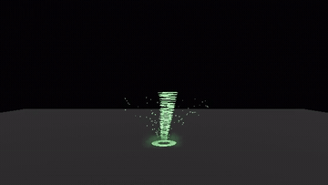<br>stylized_tornado | 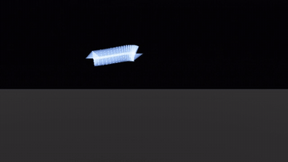<br>sword_trail |
| 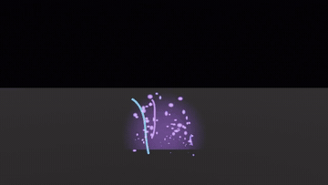<br>magic_swirl | 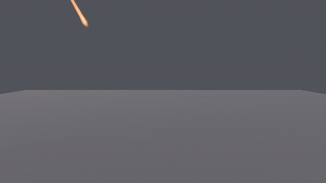<br>meteor_rain | |

## Building

The workspace builds against a Bevy 0.20-dev fork (`bevy-solari-opt`) that is referenced by local path in `Cargo.toml`; it does not build without that checkout.

Third-party Niagara files used for testing are downloaded by the scripts in `testdata/` into git-ignored folders and are not part of this repository.

Unreal, Unreal Engine and Niagara are trademarks of Epic Games, Inc. This project is not affiliated with or endorsed by Epic Games.

## License

Dual-licensed under [MIT](LICENSE-MIT) or [Apache-2.0](LICENSE-APACHE), at your option. `effects/samples/models/Fox.glb` and `examples/wizard_td/assets/models/Fox.glb` come from the Bevy repository under their own license.
